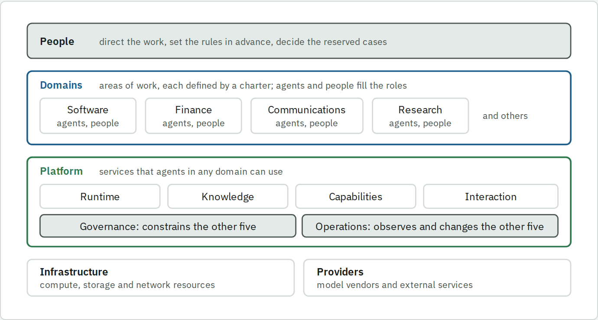
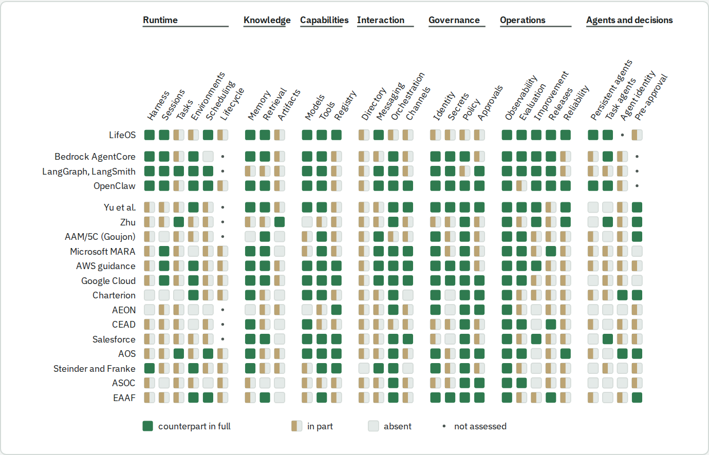
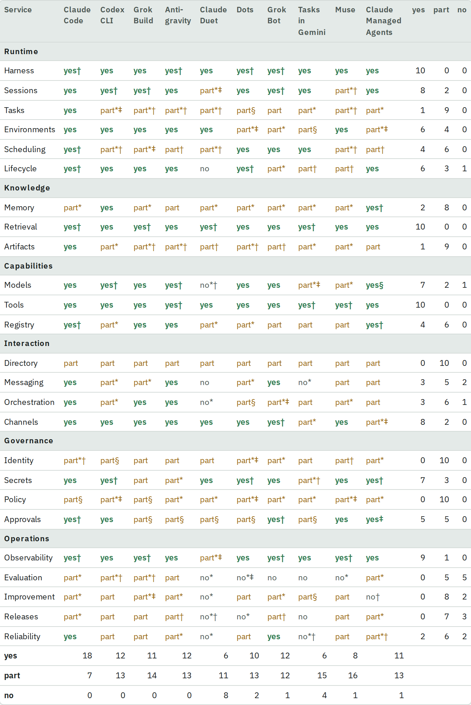
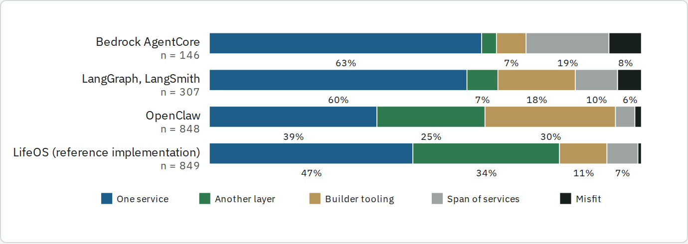

# We mapped the anatomy of an agent platform

*Dave Remy · 17 November 2026 · the short version of the working paper [WARM: the Working Agents Reference Model](https://daveremy.github.io/warm/), [doi:10.5281/zenodo.24238372](https://doi.org/10.5281/zenodo.24238372)*

My agents and I mapped the anatomy of a system where AI agents do sustained work. We call the map WARM, the Working Agents Reference Model. We drew it from the system I run, took its vocabulary from a survey of 34 sources, then checked it against three agent platforms, fourteen other published models and ten vendor products. It's a super ambitious thing to try. We've started refactoring my system toward the model, and I think the map could be useful for others who run agents.

We gave the pieces of the platform agents run on common names: 25 services in six groups. Each service has at least a partial counterpart in nine or more of the seventeen platforms and models we compared. The ten products we chose to read all rate in full on the agent loop (the model calling tools and acting on the results), retrieval and tools. For six services none of our readings established a full rating, and those six sit mostly in governance and operations. Two of the seventeen platforms and models define an area of work (like finance or software) as part of their model, or six on the other reading of the disputed ratings, and most have it only in part, though researchers specified it twenty years ago.

## The model

WARM has five layers. At the top, people direct the work and set the rules. Below them are domains. A domain is an area of work such as software or finance, written down as a charter with nine parts (goals, responsibilities, roles and rules among them), and agents and people fill the roles. The platform supplies what agents in every domain share, and below it sit infrastructure and the model providers.

The platform's 25 services fall into six groups. Runtime, Knowledge, Capabilities and Interaction cover how agents run, what they know, what they can use and whom they work with. Governance constrains all of them, and Operations is how you observe and change all of them. We also separate two kinds of agent: a persistent agent holds a role across many sessions, and a task agent is started for a single task.

## Finding 1: the platform's services are widely named

Each of the 25 services has at least a partial counterpart in nine or more of the seventeen platforms and models we compared, and eleven have one in all seventeen. When we mapped three platforms we didn't build, a reader listed each platform's components and a mapper assigned them, and between 64% and 67% landed in a single service or a single other layer. We had predicted 90%, and the share depends on how each reader divided a platform into components.

So the platform side of WARM is mostly a consolidation, and I think that is its value. People have built these services widely under different names, and a shared vocabulary lets you compare them.

## Finding 2: six services had no full rating in any product we read

We read ten products from their vendors' documentation, starting on 12 November 2026: four harnesses (products that run the agent loop, on which a builder assembles a system), five personal agents and one agent platform. We chose the ten, and they are not a sample of a larger set. All ten rate in full on the agent loop, retrieval and tools. Five rate in full on approvals, as version 0.13 of the model defines them.

For six services, none of our readings established a full rating: a directory of who is accountable for what, identity, policy, evaluation, improvement and releases. Five of those six are in the model's Governance and Operations groups. Of the table's 250 cells, 106 are yes, 127 are part and 17 are no. A rating below full means the pages we read did not state the whole definition, and the feature may exist undocumented. If you need one of those six in full, you may need more from the vendor's documentation, or an addition of your own.

## Finding 3: the work layer is old, and most models have it only in part

Two of the seventeen platforms and models define an area of work as part of their model, and six would on the other reading of the disputed ratings. Ten have one only in part. Under the stricter reading, none of the seventeen records one accountable area for each responsibility, and three would on the other reading.

The idea itself is old. The organizational multi-agent research of 2002 to 2004 specified areas of work, roles and obligations apart from the agents that fill them, and platforms of that literature joined that kind of specification to shared infrastructure. In WARM's domain layer we restate that idea for agents built on language models.

## Finding 4: mapping our own system showed its gaps

My own system, the one WARM came from, has nine persistent agents and a software development team, and its inventory listed 849 components after we removed duplicates. So far we've assigned 688 of them to a single service or layer. Mapping it also showed us what is missing: no domain has a written charter, and governance has gaps in how actions are checked and how identity is recorded.

I built the system so that agents finish work without a person approving each action. We're still setting the refactoring's measures, among them how often work stops for a person. In the model we propose recording and reviewing every stop like that, so a rule, a tool or an instruction can change and the stop doesn't repeat.

## How to use it

Take the 25 services and the nine parts of a charter as a checklist. List what your system has, assign each piece, and look at what lands nowhere and which services have nothing behind them. The method is in the paper. The supplement holds most of the evidence: the criteria, the readers' files with their quotations, and a script that recomputes the counts in the tables. Some items are withheld, and the paper's Section 7 lists them.

## Limits

WARM started from my own system, built on Claude Code. The mappings and comparisons corrected it in more than twenty places, but where it started still shapes it. The readers and raters were AI agents working for me, and most ratings have only one reader. The product ratings are readings of documentation on stated dates. We also have no evidence yet that organizing a system this way improves it. The refactoring we've started is the first test.

**Read the paper:** [daveremy.github.io/warm](https://daveremy.github.io/warm/) · [PDF](https://daveremy.github.io/warm/warm.pdf) · [repository and supplement](https://github.com/daveremy/warm) · [doi:10.5281/zenodo.24238372](https://doi.org/10.5281/zenodo.24238372)

*Created in collaboration with AI.*
